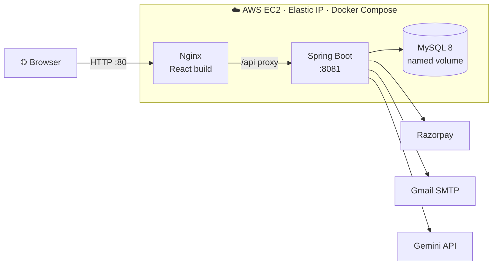
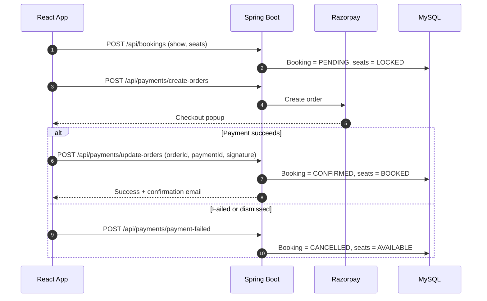
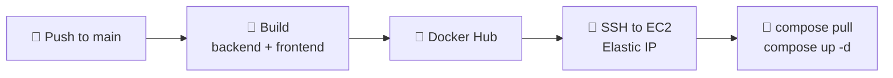

<div align="center">

# 🎬 Marquee

**Movie Ticket Booking Platform**

Pick your seats. Pay securely. Get your tickets.<br>
A full-stack booking platform with seat locking, Razorpay payments, an AI assistant, and automated CI/CD to AWS EC2.

<br>


[](http://3.109.228.45/)

<br>


<br><br>

[Features](#features) · [Screenshots](#screenshots) · [Architecture](#architecture) · [Quick Start](#quick-start) · [CI/CD](#cicd) · [Decisions](#design-decisions) · [Roadmap](#limitations--roadmap)

</div>

<br>

<a id="overview"></a>
## 📖 Overview

🔗 **Live:** [http://3.109.228.45/](http://3.109.228.45/) (hosted on AWS EC2 with an Elastic IP)

Marquee lets a user browse movies, choose a show, pick seats on a seat map, pay through Razorpay, and receive a confirmation email. The backend is a stateless Spring Boot REST API secured with JWT; the frontend is a React + Vite app served by Nginx. Everything runs in Docker containers on one AWS EC2 instance with an Elastic IP, and every push to `main` is deployed automatically by GitHub Actions.

<table>
  <tr>
    <td align="center"><b>9</b><br><sub>JPA repositories</sub></td>
    <td align="center"><b>2</b><br><sub>Docker images</sub></td>
    <td align="center"><b>1</b><br><sub>public port (80)</sub></td>
    <td align="center"><b>0</b><br><sub>secrets in the repo</sub></td>
  </tr>
</table>

<a id="features"></a>
## ✨ Features

|     | Feature | Details |
|-----|---------|---------|
| 🔐 | **Authentication** | Signup and login with JWT and a Spring Security filter chain |
| 🎞️ | **Movie discovery** | Movies, shows per movie, theaters, and screens |
| 💺 | **Seat locking** | Seats move `AVAILABLE → LOCKED → BOOKED`; locks are released on failure, cancellation, or timeout |
| 💳 | **Razorpay payments** | Order creation, payment verification, and failure handling |
| 📧 | **Email confirmation** | Sent after successful payment via Spring Mail |
| 🤖 | **AI assistant** | Chat widget backed by the Gemini API |
| ⏱️ | **Show generation** | A scheduled job keeps upcoming shows populated |

<a id="screenshots"></a>
## 📸 Screenshots

<table>
  <tr>
    <td align="center"><br><sub><b>Home</b></sub></td>
    <td align="center"><br><sub><b>Seat selection</b></sub></td>
    <td align="center"><br><sub><b>Payment</b></sub></td>
  </tr>
</table>

<a id="architecture"></a>
## 🏗️ Architecture



> [!TIP]
> Only port 80 is published. The backend and MySQL are reachable solely on the internal Docker network, and Nginx proxies `/api/*`, so the browser uses a single origin and no production CORS setup is needed.

### 🔁 Booking & Payment Flow



## 📁 Project Structure

```text
marquee-movie-booking/
├── backend/                 Spring Boot API
│   ├── src/
│   ├── pom.xml
│   └── Dockerfile           Multi-stage: Maven build → JRE runtime
├── frontend/                React + Vite app
│   ├── src/
│   ├── nginx.conf           Static hosting + /api reverse proxy
│   └── Dockerfile           Multi-stage: Node build → Nginx
├── .github/workflows/
│   └── deploy.yml           CI/CD pipeline
├── docs/screenshots/        README images
├── docker-compose.yml       Production stack
├── .env.example             Required variables (no real values)
└── README.md
```

<a id="quick-start"></a>
## 🚀 Quick Start

**Prerequisites:** Java 21 · Maven 3.9+ · Node.js 20+ · MySQL 8

```bash
git clone https://github.com/GitadarshSingh/marquee-movie-booking.git
cd marquee-movie-booking
```

<details>
<summary><b>▶ Backend</b> — http://localhost:8081</summary>

<br>

The database defaults to `localhost:3306/bms_db` and is created automatically. Provide the other secrets as environment variables:

```bash
cd backend
export RAZORPAY_KEY_ID=...
export RAZORPAY_KEY_SECRET=...
export MAIL_USERNAME=...
export MAIL_PASSWORD=...        # Gmail app password
export GEMINI_API_KEY=...
mvn spring-boot:run
```

> PowerShell: `$env:RAZORPAY_KEY_ID="..."`

</details>

<details>
<summary><b>▶ Frontend</b> — http://localhost:5173</summary>

<br>

```bash
cd frontend
npm install
npm run dev
```

</details>

## ⚙️ Configuration

| Variable | Purpose |
|----------|---------|
| `DB_URL` · `DB_USERNAME` · `DB_PASSWORD` | MySQL connection (local defaults provided) |
| `RAZORPAY_KEY_ID` · `RAZORPAY_KEY_SECRET` | Razorpay credentials (test mode) |
| `MAIL_USERNAME` · `MAIL_PASSWORD` | SMTP account and app password |
| `GEMINI_API_KEY` | Gemini API access |

> [!IMPORTANT]
> The real `.env` lives only on the server and is never committed. The Razorpay Key ID is a public identifier used by the frontend; the Key Secret stays on the backend.

<a id="cicd"></a>
## 🔄 CI/CD: GitHub Actions → AWS EC2

Every push to `main` builds both images, publishes them to Docker Hub, and redeploys the EC2 instance.



| Stage | Action |
|-------|--------|
| **Build** | Docker Buildx builds `backend/` and `frontend/` with layer caching |
| **Publish** | Pushed to Docker Hub as `backend-latest` / `frontend-latest` plus a commit-SHA tag |
| **Deploy** | SSH into EC2, `docker compose pull`, `docker compose up -d` |
| **Cleanup** | `docker image prune -f` |

> [!NOTE]
> **Why an Elastic IP?** A regular EC2 public IP changes after a stop/start. An Elastic IP (currently `3.109.228.45`) is static, so the pipeline's SSH host never goes stale and a domain can be attached later.

### 🔑 GitHub Secrets

| Secret | Value |
|--------|-------|
| `DOCKERHUB_USERNAME` | Docker Hub username |
| `DOCKERHUB_TOKEN` | Docker Hub access token |
| `EC2_HOST` | Elastic IP |
| `EC2_USER` | `ec2-user` |
| `EC2_SSH_KEY` | Private key (`.pem`) contents |

### 🖥️ Server prerequisites

Amazon Linux 2023 with Docker and the Compose plugin, the Elastic IP associated, and `docker-compose.yml` plus `.env` in `/home/ec2-user`.

| Port | Source | Purpose |
|------|--------|---------|
| 80 | `0.0.0.0/0` | Web traffic |
| 22 | `0.0.0.0/0` | SSH for the pipeline (key-based only) |

> [!WARNING]
> GitHub-hosted runners use changing IPs, so SSH cannot be limited to one address. Access relies on the private key. A self-hosted runner or AWS Systems Manager would let you close port 22.

<details>
<summary><b>📄 docker-compose.yml (production)</b></summary>

<br>

```yaml
services:
  mysql:
    image: mysql:8
    restart: always
    environment:
      MYSQL_ROOT_PASSWORD: ${DB_PASSWORD}
      MYSQL_DATABASE: bms_db
    volumes:
      - mysql_data:/var/lib/mysql

  backend:
    image: adarshwithdocker/marquee:backend-latest
    restart: always
    depends_on:
      - mysql
    environment:
      DB_URL: jdbc:mysql://mysql:3306/bms_db?createDatabaseIfNotExist=true
      DB_USERNAME: root
      DB_PASSWORD: ${DB_PASSWORD}
      RAZORPAY_KEY_ID: ${RAZORPAY_KEY_ID}
      RAZORPAY_KEY_SECRET: ${RAZORPAY_KEY_SECRET}
      MAIL_USERNAME: ${MAIL_USERNAME}
      MAIL_PASSWORD: ${MAIL_PASSWORD}
      GEMINI_API_KEY: ${GEMINI_API_KEY}

  frontend:
    image: adarshwithdocker/marquee:frontend-latest
    restart: always
    ports:
      - "80:80"
    depends_on:
      - backend

volumes:
  mysql_data:
```

</details>

<details>
<summary><b>📄 .github/workflows/deploy.yml</b></summary>

<br>

```yaml
name: CI/CD - Build and Deploy to EC2

on:
  push:
    branches: [main]
  workflow_dispatch:

concurrency:
  group: deploy-${{ github.ref }}
  cancel-in-progress: true

permissions:
  contents: read

env:
  IMAGE: ${{ secrets.DOCKERHUB_USERNAME }}/marquee

jobs:
  build-and-push:
    runs-on: ubuntu-latest
    timeout-minutes: 20
    steps:
      - name: Checkout code
        uses: actions/checkout@v4

      - name: Set up Docker Buildx
        uses: docker/setup-buildx-action@v3

      - name: Login to Docker Hub
        uses: docker/login-action@v3
        with:
          username: ${{ secrets.DOCKERHUB_USERNAME }}
          password: ${{ secrets.DOCKERHUB_TOKEN }}

      - name: Build and push backend
        uses: docker/build-push-action@v6
        with:
          context: ./backend
          push: true
          tags: |
            ${{ env.IMAGE }}:backend-latest
            ${{ env.IMAGE }}:backend-${{ github.sha }}
          cache-from: type=gha,scope=backend
          cache-to: type=gha,scope=backend,mode=max

      - name: Build and push frontend
        uses: docker/build-push-action@v6
        with:
          context: ./frontend
          push: true
          tags: |
            ${{ env.IMAGE }}:frontend-latest
            ${{ env.IMAGE }}:frontend-${{ github.sha }}
          cache-from: type=gha,scope=frontend
          cache-to: type=gha,scope=frontend,mode=max

  deploy:
    needs: build-and-push
    runs-on: ubuntu-latest
    timeout-minutes: 10
    steps:
      - name: Deploy to EC2
        uses: appleboy/ssh-action@v1.2.0
        with:
          host: ${{ secrets.EC2_HOST }}
          username: ${{ secrets.EC2_USER }}
          key: ${{ secrets.EC2_SSH_KEY }}
          script_stop: true
          script: |
            set -e
            cd /home/ec2-user
            docker compose pull
            docker compose up -d --remove-orphans
            docker image prune -f
            docker compose ps
```

</details>

> ⏪ **Rollback:** every build also carries a commit-SHA tag. Point the compose file at an older SHA and run `docker compose up -d`.

<a id="design-decisions"></a>
## 🧠 Design Decisions

| Decision | Why |
|----------|-----|
| **Stateless JWT auth** | No server-side session, so the API scales horizontally and the frontend just sends a bearer token |
| **Seat status + lock timestamp** | Seats become `LOCKED` at booking and `BOOKED` only after payment is verified; a scheduler frees stale locks so abandoned checkouts never block seats |
| **Booking starts as `PENDING`** | Payment can fail or be dismissed; the booking is confirmed only after verification and cancelled (seats freed) otherwise |
| **Nginx reverse proxy** | One public port, no backend IP baked into the frontend, no production CORS |
| **Multi-stage Dockerfiles** | Maven and Node stay out of the final images, keeping them small |
| **Secrets via environment variables** | Images contain no credentials, so one image runs locally and in production |
| **Elastic IP** | Stable deployment target for CI/CD and a future domain |
| **Named volume for MySQL** | Data survives container recreation during redeploys |

<a id="limitations--roadmap"></a>
## ⚠️ Limitations & Roadmap

Current scope, stated openly:

- [ ] HTTPS with a custom domain (Caddy or Nginx + Let's Encrypt). Currently HTTP only.
- [ ] Amazon RDS with automated backups instead of a containerized database
- [ ] Flyway migrations instead of Hibernate `ddl-auto=update`
- [ ] Automated tests in the pipeline (the Docker build currently uses `-DskipTests`)
- [ ] Deploy by commit-SHA tag instead of mutable `latest`
- [ ] Close port 22 using a self-hosted runner or AWS Systems Manager
- [ ] Monitoring and centralized logging

## 📡 API Reference

| Area | Endpoints |
|------|-----------|
| **Auth** | `POST /api/auth/signup` · `POST /api/auth/login` · `GET /api/auth/check-phone` |
| **Movies** | `GET /api/movies` |
| **Shows** | `GET /api/shows/movie/{movieId}` |
| **Seats** | `GET /api/show-seats/show/{showId}` |
| **Bookings** | `POST /api/bookings` · `GET /api/bookings/user/{userId}` · `PUT /api/bookings/{id}/cancel` |
| **Payments** | `POST /api/payments/create-orders` · `POST /api/payments/update-orders` · `POST /api/payments/payment-failed` |
| **AI** | `POST /api/ai/chat` |

Protected endpoints require `Authorization: Bearer <token>`.

## 👨‍💻 Author

<table>
  <tr>
    <td>
      <b>Adarsh Singh</b><br>
      Final-year B.Tech CSE · Galgotias University<br>
      Java · Spring Boot · React · Docker · AWS<br><br>
      <a href="https://www.linkedin.com/in/adarsh-singh-backend/"></a>
      <a href="https://github.com/GitadarshSingh"></a>
    </td>
  </tr>
</table>

## 📄 License

Distributed under the terms of the [LICENSE](LICENSE) file.

<div align="center">
  <br>

  ⭐ If this project helped you, consider starring the repo.

</div>
