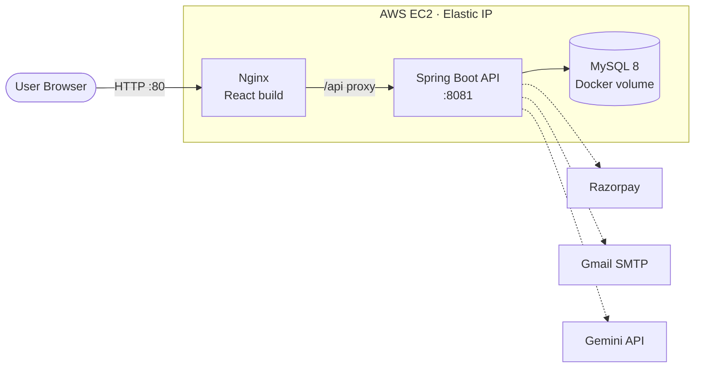
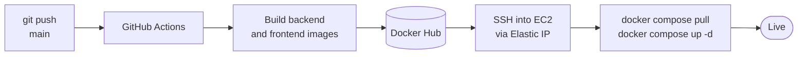

<div align="center">

# 🎬 Marquee

### A full-stack movie ticket booking platform

Real-time seat selection · Secure Razorpay payments · AI assistant · Automated CI/CD on AWS EC2

<br>


<br>

[Features](#-features) ·
[Architecture](#-architecture) ·
[Quick Start](#-quick-start) ·
[CI/CD](#-cicd-pipeline-github-actions--aws-ec2) ·
[API](#-api-reference) ·
[Author](#-author)

</div>

---

## 📖 Overview

**Marquee** lets users browse movies, pick seats on an interactive seat map, pay online, and receive an email confirmation, all in one flow. The backend is a stateless **Spring Boot** REST API secured with **JWT**; the frontend is a **React + Vite** single-page app served by **Nginx**.

The project is fully containerized and ships through an automated **GitHub Actions** pipeline that builds images, publishes them to Docker Hub, and deploys to an **AWS EC2** instance addressed by a static **Elastic IP**.

## ✨ Features

| | Feature | Description |
|---|---|---|
| 🔐 | **Authentication** | Signup and login with JWT and Spring Security |
| 🎞️ | **Movie discovery** | Browse movies, theaters, screens, and show timings |
| 💺 | **Smart seat locking** | Seats are locked during checkout and auto-released if payment is abandoned, preventing double booking |
| 💳 | **Razorpay payments** | Order creation, server-side signature verification, and failure handling that frees seats |
| 📧 | **Email confirmations** | Booking confirmation sent after successful payment |
| 🤖 | **AI assistant** | In-app chat widget powered by the Gemini API |
| ⏱️ | **Auto show generation** | A scheduler keeps upcoming shows populated |
| 📱 | **Responsive UI** | Works across desktop and mobile |

## 🧰 Tech Stack

| Layer | Technologies |
|---|---|
| **Backend** | Java 21, Spring Boot 4.0.6, Spring Security, Spring Data JPA, Hibernate, JWT (jjwt) |
| **Frontend** | React, Vite, JavaScript, CSS |
| **Database** | MySQL 8 |
| **Integrations** | Razorpay, Gmail SMTP, Gemini API |
| **Infrastructure** | Docker, Docker Compose, Nginx, AWS EC2, Elastic IP |
| **CI/CD** | GitHub Actions, Docker Hub |

## 🏗️ Architecture



- Nginx serves the React build and proxies every `/api` request to the backend over the internal Docker network.
- The backend and database are **not** exposed publicly. The browser talks to one origin, so there are no CORS headaches.

## 📁 Project Structure

```
marquee-movie-booking/
├── backend/                  # Spring Boot REST API
│   ├── src/
│   ├── pom.xml
│   └── Dockerfile
├── frontend/                 # React + Vite SPA
│   ├── src/
│   ├── nginx.conf
│   └── Dockerfile
├── .github/workflows/
│   └── deploy.yml            # CI/CD pipeline
├── docker-compose.yml        # Production stack
├── .env.example              # Required environment variables
└── README.md
```

## 🚀 Quick Start

**Prerequisites:** Java 21, Maven 3.9+, Node.js 20+, MySQL 8 (or Docker).

```bash
# 1. Clone
git clone https://github.com/GitadarshSingh/marquee-movie-booking.git
cd marquee-movie-booking
```

<details>
<summary><b>Run the backend</b> (http://localhost:8081)</summary>

<br>

The database defaults to `localhost:3306/bms_db`. Provide the remaining secrets as environment variables:

```bash
cd backend
export RAZORPAY_KEY_ID=your_key_id
export RAZORPAY_KEY_SECRET=your_key_secret
export MAIL_USERNAME=your_email
export MAIL_PASSWORD=your_app_password
export GEMINI_API_KEY=your_gemini_key
mvn spring-boot:run
```

On Windows PowerShell, use `$env:RAZORPAY_KEY_ID="..."` instead of `export`.

</details>

<details>
<summary><b>Run the frontend</b> (http://localhost:5173)</summary>

<br>

```bash
cd frontend
npm install
npm run dev
```

</details>

## ⚙️ Configuration

No secrets live in the repository. The backend reads everything from environment variables, with safe defaults for local development.

| Variable | Description |
|---|---|
| `DB_URL` | JDBC URL (default: local `bms_db`) |
| `DB_USERNAME` | Database user (default: `root`) |
| `DB_PASSWORD` | Database password |
| `RAZORPAY_KEY_ID` | Razorpay key ID |
| `RAZORPAY_KEY_SECRET` | Razorpay key secret |
| `MAIL_USERNAME` | SMTP account |
| `MAIL_PASSWORD` | SMTP app password |
| `GEMINI_API_KEY` | Gemini API key |

> [!IMPORTANT]
> Never commit a real `.env` file. On the server, copy `.env.example` to `.env` and fill in real values.

---

## 🔄 CI/CD Pipeline: GitHub Actions → AWS EC2

Every push to `main` automatically builds, publishes, and deploys the application.



| Stage | What happens |
|---|---|
| **1. Build** | Backend and frontend images are built with Docker Buildx (with layer caching). |
| **2. Publish** | Images are pushed to Docker Hub as `backend-latest` / `frontend-latest`, plus an immutable `-<git-sha>` tag for rollbacks. |
| **3. Deploy** | The workflow SSHes into EC2, pulls the new images, and restarts containers. The database volume is untouched. |
| **4. Cleanup** | Dangling images are pruned to save disk space. |

### 📌 Why an Elastic IP?

A regular EC2 public IP changes every time the instance is stopped and started. An **Elastic IP** is a static address, so the pipeline's SSH target (`EC2_HOST`) never goes stale, and a domain or HTTPS certificate can be attached later without changes.

### 🖥️ Server setup (one time)

Keep these in `/home/ec2-user` on the instance (Docker and Compose plugin installed, Elastic IP associated):

<details>
<summary><b>docker-compose.yml</b></summary>

<br>

```yaml
services:
  mysql:
    image: mysql:8
    restart: always
    environment:
      MYSQL_ROOT_PASSWORD: ${DB_PASSWORD}
      MYSQL_DATABASE: bms_db
    volumes:
      - mysql_data:/var/lib/mysql

  backend:
    image: adarshwithdocker/marquee:backend-latest
    restart: always
    depends_on:
      - mysql
    environment:
      DB_URL: jdbc:mysql://mysql:3306/bms_db?createDatabaseIfNotExist=true
      DB_USERNAME: root
      DB_PASSWORD: ${DB_PASSWORD}
      RAZORPAY_KEY_ID: ${RAZORPAY_KEY_ID}
      RAZORPAY_KEY_SECRET: ${RAZORPAY_KEY_SECRET}
      MAIL_USERNAME: ${MAIL_USERNAME}
      MAIL_PASSWORD: ${MAIL_PASSWORD}
      GEMINI_API_KEY: ${GEMINI_API_KEY}

  frontend:
    image: adarshwithdocker/marquee:frontend-latest
    restart: always
    ports:
      - "80:80"
    depends_on:
      - backend

volumes:
  mysql_data:
```

</details>

**Security group (inbound)**

| Port | Source | Purpose |
|---|---|---|
| 80 | `0.0.0.0/0` | Web traffic |
| 443 | `0.0.0.0/0` | HTTPS (once a domain is attached) |
| 22 | `0.0.0.0/0` | SSH for the pipeline, key-based auth only |

> [!NOTE]
> GitHub-hosted runners use changing IP ranges, so port 22 can't be pinned to one address. Access is protected by the private key stored in GitHub Secrets. For tighter control, use a self-hosted runner or AWS Systems Manager.

### 🔑 GitHub Secrets

Add under **Settings → Secrets and variables → Actions**:

| Secret | Value |
|---|---|
| `DOCKERHUB_USERNAME` | Docker Hub username |
| `DOCKERHUB_TOKEN` | Docker Hub access token |
| `EC2_HOST` | Elastic IP of the instance |
| `EC2_USER` | `ec2-user` |
| `EC2_SSH_KEY` | Full contents of the `.pem` private key |

### 📜 Workflow

<details>
<summary><b>.github/workflows/deploy.yml</b></summary>

<br>

```yaml
name: CI/CD - Build and Deploy to EC2

on:
  push:
    branches: [main]
  workflow_dispatch:

env:
  IMAGE: ${{ secrets.DOCKERHUB_USERNAME }}/marquee

jobs:
  build-and-push:
    runs-on: ubuntu-latest
    steps:
      - uses: actions/checkout@v4

      - uses: docker/setup-buildx-action@v3

      - uses: docker/login-action@v3
        with:
          username: ${{ secrets.DOCKERHUB_USERNAME }}
          password: ${{ secrets.DOCKERHUB_TOKEN }}

      - name: Build and push backend
        uses: docker/build-push-action@v6
        with:
          context: ./backend
          push: true
          tags: |
            ${{ env.IMAGE }}:backend-latest
            ${{ env.IMAGE }}:backend-${{ github.sha }}
          cache-from: type=gha,scope=backend
          cache-to: type=gha,scope=backend,mode=max

      - name: Build and push frontend
        uses: docker/build-push-action@v6
        with:
          context: ./frontend
          push: true
          tags: |
            ${{ env.IMAGE }}:frontend-latest
            ${{ env.IMAGE }}:frontend-${{ github.sha }}
          cache-from: type=gha,scope=frontend
          cache-to: type=gha,scope=frontend,mode=max

  deploy:
    needs: build-and-push
    runs-on: ubuntu-latest
    steps:
      - name: Deploy to EC2
        uses: appleboy/ssh-action@v1.2.0
        with:
          host: ${{ secrets.EC2_HOST }}
          username: ${{ secrets.EC2_USER }}
          key: ${{ secrets.EC2_SSH_KEY }}
          script: |
            cd /home/ec2-user
            docker compose pull
            docker compose up -d
            docker image prune -f
            docker compose ps
```

</details>

### ✅ Verify a deployment

1. **Actions** tab: both jobs should be green.
2. Open `http://<ELASTIC_IP>`: the app should load.
3. On the server: `docker compose logs --tail 50 backend` should end with `Started BookmyshowApplication`.

### ⏪ Rollback

Every build is also tagged with its commit SHA. Change the image tags in the server's `docker-compose.yml` to an earlier SHA and run `docker compose up -d`.

---

## 📡 API Reference

| Area | Method and endpoint |
|---|---|
| **Auth** | `POST /api/auth/signup` · `POST /api/auth/login` · `GET /api/auth/check-phone` |
| **Movies** | `GET /api/movies` |
| **Shows** | `GET /api/shows/movie/{movieId}` |
| **Seats** | `GET /api/show-seats/show/{showId}` |
| **Bookings** | `POST /api/bookings` · `GET /api/bookings/user/{userId}` · `PUT /api/bookings/{id}/cancel` |
| **Payments** | `POST /api/payments/create-orders` · `POST /api/payments/update-orders` · `POST /api/payments/payment-failed` |
| **AI** | `POST /api/ai/chat` |

Protected endpoints expect `Authorization: Bearer <token>`.

## 🔒 Security

- Secrets are injected via environment variables and GitHub Secrets, never committed.
- Stateless JWT authentication with Spring Security.
- Razorpay signatures are verified server-side before a booking is confirmed.
- Database and backend are reachable only inside the Docker network.
- Deployment uses key-based SSH only.

## 🗺️ Roadmap

- [ ] HTTPS with a custom domain (Caddy or Nginx + Let's Encrypt)
- [ ] Automated tests in the pipeline before deploy
- [ ] Managed database (Amazon RDS) with automated backups
- [ ] Monitoring and centralized logging

## 👨‍💻 Author

**Adarsh Singh**
Final-year Computer Science & Engineering student · Galgotias University

[](https://www.linkedin.com/in/adarsh-singh-backend/)
[](https://github.com/GitadarshSingh)

## 📄 License

Distributed under the terms of the [LICENSE](LICENSE) file.

<div align="center">

<br>

⭐ If you found this project useful, consider giving it a star.

</div>
